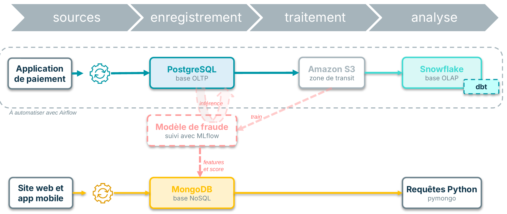
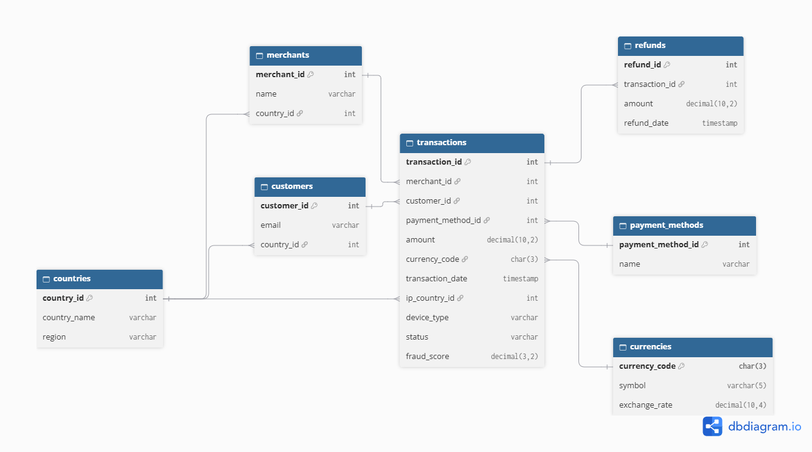
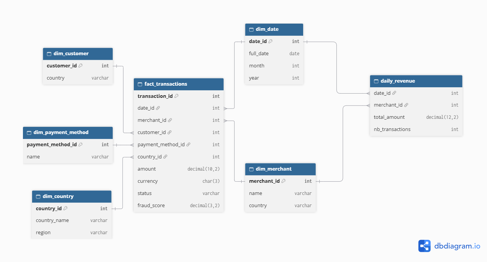

# Bloc 2 – Projet Stripe : From SQL to NoSQL

Lien GitHub du projet : https://github.com/sandrinehardy/mes_projets_jedha_dsl/tree/main/bloc2_architecture_donnees

Projet du bloc 2 (architecture de données, option Lead). Conception de l'architecture de données de Stripe, avec une base adaptée à chaque usage :

- une base **OLTP** (PostgreSQL) pour enregistrer les paiements de façon fiable
- une base **OLAP** (Snowflake) pour analyser les transactions
- une base **NoSQL** (MongoDB) pour les données libres : logs, sessions, avis, features du modèle de fraude

Le projet est une conception. Une démonstration avec des données fictives montre MongoDB et Snowflake en fonctionnement.

Vidéo de démonstration (environ 2 min) : https://drive.google.com/file/d/1sAtswRuOun08eh-0SFheRmqxkSkIUOGn/view?usp=sharing

## Architecture

| Brique | Rôle | Hébergement |
| --- | --- | --- |
| PostgreSQL | Base OLTP : paiements, marchands, clients (modèle normalisé) | Conception uniquement |
| Snowflake | Base OLAP : schéma en étoile et table agrégée `daily_revenue` | Cloud (démonstration réalisée) |
| MongoDB | Base NoSQL : logs, sessions, features du modèle, avis | Docker en local (démonstration réalisée) |
| Amazon S3 | Zone de transit des fichiers | AWS |
| MLflow | Suivi du modèle de fraude (bloc 3) | Conception uniquement |

### Le trajet d'une donnée

1. **Enregistrer** : le paiement est écrit dans PostgreSQL (OLTP).
2. **Déposer** : les données sont déposées dans S3 (zone de transit).
3. **Charger** : Snowflake lit les fichiers depuis S3 (stage puis `COPY INTO`), MongoDB reçoit les documents.
4. **Analyser** : les requêtes SQL interrogent le schéma en étoile, les requêtes Python interrogent les collections MongoDB.

### Les trois bases

| Base | Données | Modèle |
| --- | --- | --- |
| OLTP (PostgreSQL) | transactions, marchands, clients, moyens de paiement, devises, remboursements | tables normalisées |
| OLAP (Snowflake) | `fact_transactions`, 5 tables `dim_`, `daily_revenue` | schéma en étoile |
| NoSQL (MongoDB) | `logs`, `user_sessions`, `ml_features`, `customer_feedback` | documents (imbriqué ou référencé) |

## Contenu du dossier

- `bloc2_presentation.pdf` : présentation (architecture, schémas des bases, démonstration)
- `captures_bloc2_demonstration.pdf` : captures d'écran de la démonstration
- `schemas/architecture_donnees.png` : schéma de l'architecture de données
- `schemas/oltp_transactions.dbml` et `.png` : schéma de la base OLTP
- `schemas/olap_star_schema.dbml` et `olap_analyses.png` : schéma en étoile de la base OLAP
- `schemas/nosql_mongodb_model.md` : collections MongoDB
- `schemas/requetes_sql_nosql.md` : 4 requêtes SQL et 3 requêtes MongoDB, avec la question métier
- `demo/` : `docker-compose.yaml`, `charger_mongodb.py`, `requetes_mongodb.py`, `snowflake_demo.sql` et `.env.example`

Les fichiers `.dbml` se visualisent en les collant dans [dbdiagram.io](https://dbdiagram.io).

## Variables d'environnement

Voir `demo/.env.example`.

| Variable | Rôle |
| --- | --- |
| `AWS_ACCESS_KEY_ID`, `AWS_SECRET_ACCESS_KEY`, `AWS_DEFAULT_REGION`, `BUCKET_NAME` | accès au bucket S3 |

## Résultats et pistes d'amélioration

- Conception d'une architecture de données qui permet de faire des requêtes et des analyses sur des données structurées et non structurées. 

**Schéma de l'architecture de données**

L'automatisation (cadre « à automatiser avec Airflow » et dbt) n'est pas réalisée.

**Schéma de la base OLTP (PostgreSQL)**

**Schéma en étoile de la base OLAP (Snowflake)**

Pour aller plus loin : 

- Automatisation des flux avec dbt et Airflow (ou autre outil)
- Utilisation d'un vrai modèle de prédiction avec MLFlow
